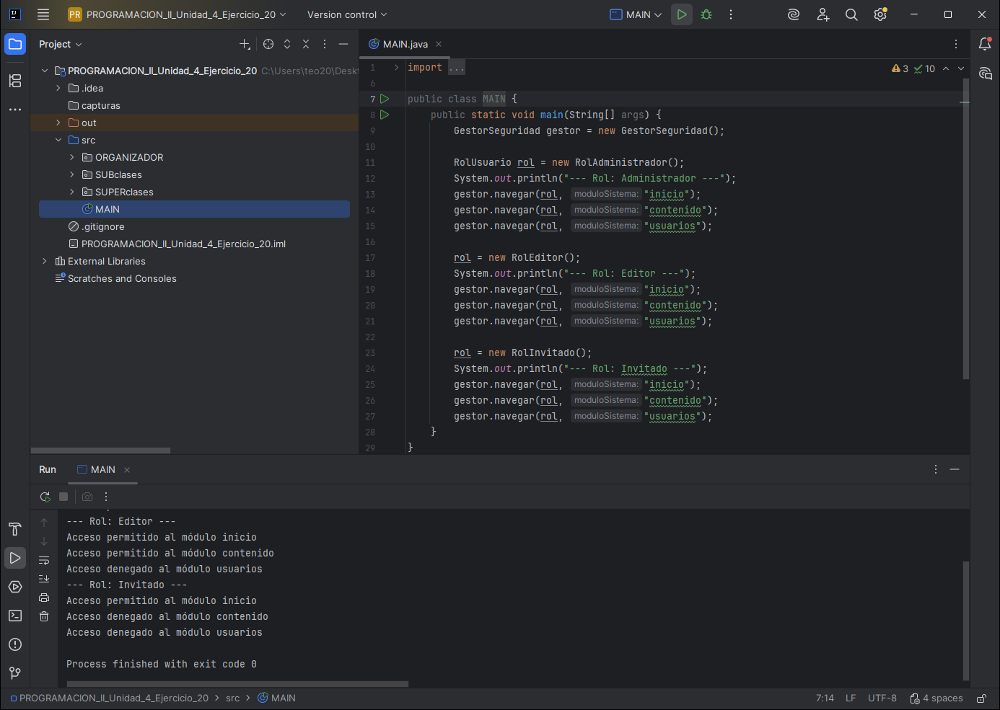

# PROGRAMACIÓN II — Unidad 4, Ejercicio 20: El Sistema de Gestión de Permisos y Roles de Usuario

Trabajo práctico de Programación II. Este repositorio contiene la resolución en Java del ejercicio 20 de la Unidad 4.

## Consigna

#### Contexto

Una plataforma de software empresarial restringe o habilita funcionalidades según el perfil de seguridad que posea el usuario conectado (administradores de sistema, editores de contenido y lectores invitados). El módulo de control de acceso procesa las autorizaciones de forma polimórfica, validando los permisos sin conocer los detalles lógicos internos de cada rol.

#### Consigna

Implementar un subsistema de seguridad en Java que utilice polimorfismo para verificar permisos de ejecución a través de diversos roles de usuario desacoplados.

#### Desarrollo requerido

- Definir una interfaz o clase abstracta RolUsuario comúnmente provista con el método abstracto boolean verificarPermisoAcceso(String moduloSistema).
- Crear clases concretas como RolAdministrador, RolEditor y RolInvitado que implementen el contrato con sus matrices de permisos específicas.
- Desarrollar la clase coordinadora GestorSeguridad que reciba el rol del usuario de forma polimórfica para aprobar o denegar la navegación en los módulos.
- En el método main, simular intentos de acceso a distintas secciones intercambiando dinámicamente los roles de usuario y reflejar el resultado por consola.

## Estructura del repositorio

```
PROGRAMACION_II_Unidad_4_Ejercicio_20/
├── README.md
├── capturas/
│   └── consola.png
└── src/
    ├── ORGANIZADOR/
    │   └── GestorSeguridad.java
    ├── SUBclases/
    │   ├── RolAdministrador.java
    │   ├── RolEditor.java
    │   └── RolInvitado.java
    ├── SUPERclases/
    │   └── RolUsuario.java
    └── MAIN.java   # clase con el método main
```

## Funcionamiento y lógica

El ejercicio aplica **polimorfismo con una interfaz** en un subsistema de seguridad: cada rol de usuario define a qué módulos puede entrar. Está organizado en los paquetes `SUPERclases`, `SUBclases` y `ORGANIZADOR`.

### `SUPERclases.RolUsuario` (interfaz)

Define `boolean verificarPermisoAcceso(String moduloSistema)`.

### `SUBclases`

- **`RolAdministrador`:** tiene acceso a todos los módulos.
- **`RolEditor`:** puede entrar a "inicio", "contenido" y "reportes".
- **`RolInvitado`:** solo puede entrar a "inicio".

### `ORGANIZADOR.GestorSeguridad`

Su método `navegar(rol, modulo)` le pregunta al rol si tiene permiso e informa si el acceso se permite o se deniega.

### `MAIN`

Usa una variable de tipo `RolUsuario` y le asigna cada rol, uno por vez, intentando entrar a los módulos inicio, contenido y usuarios:

| Rol | inicio | contenido | usuarios |
|---|---|---|---|
| Administrador | permitido | permitido | permitido |
| Editor | permitido | permitido | denegado |
| Invitado | permitido | denegado | denegado |

## Ejecución

Captura de la consola de IntelliJ IDEA ejecutando el programa:



Salida obtenida:

```
--- Rol: Administrador ---
Acceso permitido al módulo inicio
Acceso permitido al módulo contenido
Acceso permitido al módulo usuarios
--- Rol: Editor ---
Acceso permitido al módulo inicio
Acceso permitido al módulo contenido
Acceso denegado al módulo usuarios
--- Rol: Invitado ---
Acceso permitido al módulo inicio
Acceso denegado al módulo contenido
Acceso denegado al módulo usuarios
```
